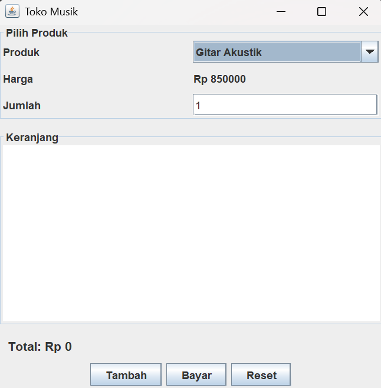
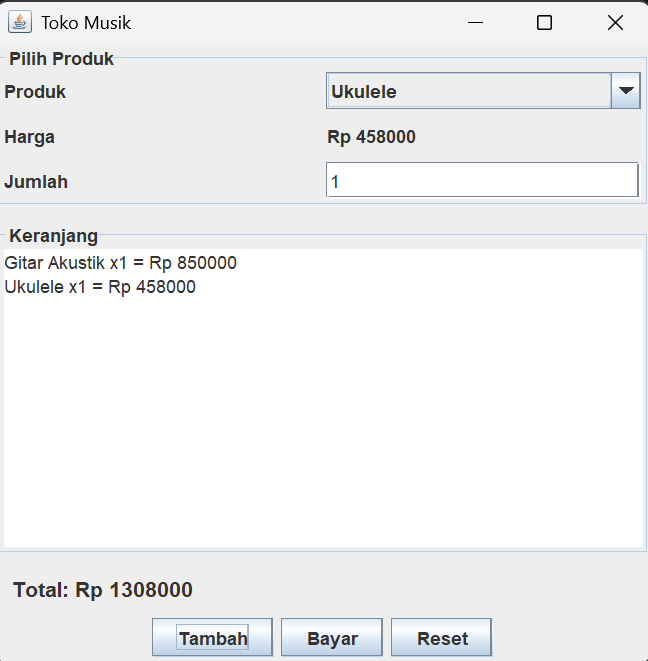
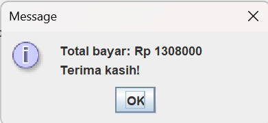

# Java Swing GUI Exercise: Toko Musik (PBO)

A simple Java Swing desktop application for a music store. It was made for the Pemrograman Berorientasi Objek (PBO) course to show how the five main parts of a Java GUI work together: top level container, intermediate container, atomic component, layout, and event handling.

## About the Application

The user picks an instrument from a dropdown, and the price label updates to match the selection. After typing a quantity, the Tambah button adds the item to the cart list and the total is updated. The Bayar button shows a message with the total to pay, and the Reset button clears the cart and sets the total back to zero. If the quantity is not a positive number, an error dialog appears.

## Project Structure

```
Main.java
Produk.java
FormPanel.java
KeranjangPanel.java
TokoMusikFrame.java
```

Main.java is the entry point of the program. Produk.java holds the data of one product (name and price). FormPanel.java is the panel for choosing a product and entering the quantity. KeranjangPanel.java is the scrollable cart list. TokoMusikFrame.java is the main window that puts everything together and handles the button clicks.

## The 5 GUI Parts

### 1. Top Level Container

The top level container is `javax.swing.JFrame`. It is the main window where all other components are placed. In this project it is the class `TokoMusikFrame`.

```java
public class TokoMusikFrame extends JFrame implements ActionListener {
    setTitle("Toko Musik");
    setSize(450, 450);
    setDefaultCloseOperation(EXIT_ON_CLOSE);
    setLocationRelativeTo(null);
}
```

### 2. Intermediate Container

Intermediate containers group other components before they are added to the window. This project uses `javax.swing.JPanel` and `javax.swing.JScrollPane`, with four containers in total.

1. `FormPanel`, a class that extends `JPanel`
2. `KeranjangPanel`, a class that extends `JScrollPane`
3. `panel`, a `JPanel` in the method `buatPanelBawah()`
4. `panelTombol`, a `JPanel` in the method `buatPanelBawah()`

```java
public class FormPanel extends JPanel implements ActionListener {
}

public class KeranjangPanel extends JScrollPane {
    setViewportView(area);
}

JPanel panel = new JPanel(new BorderLayout());
JPanel panelTombol = new JPanel(new FlowLayout());
```

### 3. Atomic Components

Atomic components are basic controls that do not hold other components. This project uses `JLabel`, `JButton`, `JComboBox`, `JTextField`, and `JTextArea`. `JOptionPane` is also used for the message dialogs.

```java
cmbProduk = new JComboBox<>(namaProduk);
txtJumlah = new JTextField("1");
lblHarga = new JLabel("Rp " + daftarProduk[0].getHarga());
area = new JTextArea();

btnTambah = new JButton("Tambah");
btnBayar = new JButton("Bayar");
btnReset = new JButton("Reset");
```

### 4. Layout Classes

Three layout managers are used to arrange the components.

1. `BorderLayout` for the main window and for the bottom panel. In the main window, the form is placed in NORTH, the cart in CENTER, and the bottom panel in SOUTH.
2. `GridLayout` for the form panel, arranged as 3 rows and 2 columns.
3. `FlowLayout` for the button panel, so the buttons are placed side by side.

```java
setLayout(new BorderLayout(10, 10));
add(formPanel, BorderLayout.NORTH);
add(keranjangPanel, BorderLayout.CENTER);
add(buatPanelBawah(), BorderLayout.SOUTH);

setLayout(new GridLayout(3, 2, 5, 5));

JPanel panelTombol = new JPanel(new FlowLayout());
```

### 5. Event Listener and Event Handling

The interface used is `java.awt.event.ActionListener`, with the method `actionPerformed(ActionEvent e)`. Two classes handle events.

The first is `TokoMusikFrame`, which handles the Tambah, Bayar, and Reset buttons. The method `e.getSource()` is used to check which button was clicked.

```java
btnTambah.addActionListener(this);
btnBayar.addActionListener(this);
btnReset.addActionListener(this);

@Override
public void actionPerformed(ActionEvent e) {
    Object sumber = e.getSource();

    if (sumber == btnTambah) {
        tambahKeranjang();
    } else if (sumber == btnBayar) {
        bayar();
    } else if (sumber == btnReset) {
        reset();
    }
}
```

The second is `FormPanel`, which handles the product dropdown. When the selected product changes, the price label is updated.

```java
cmbProduk.addActionListener(this);

@Override
public void actionPerformed(ActionEvent e) {
    lblHarga.setText("Rp " + getProdukDipilih().getHarga());
}
```

Invalid quantity input is handled with a `NumberFormatException` that is caught in `tambahKeranjang()`, which then shows an error dialog.

## Screenshots

### 1. Main Window



### 2. Cart After Adding Items



### 3. Payment Message



## How to Run

1. Make sure the JDK is installed.
2. Open the project folder in VS Code or any Java IDE.
3. Compile all the source files:
   ```bash
   javac *.java
   ```
4. Run the application:
   ```bash
   java Main
   ```
